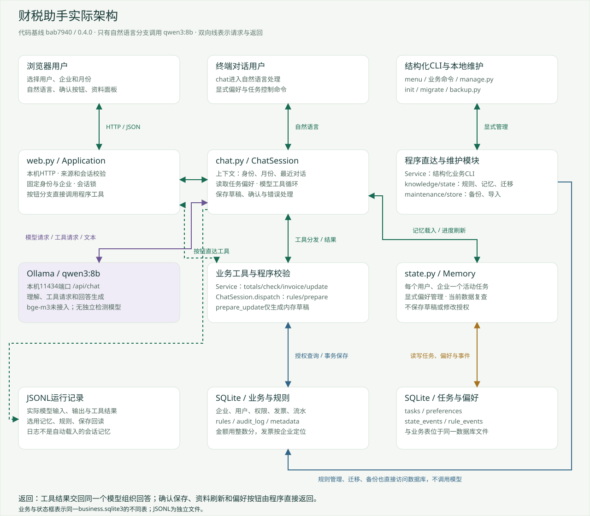
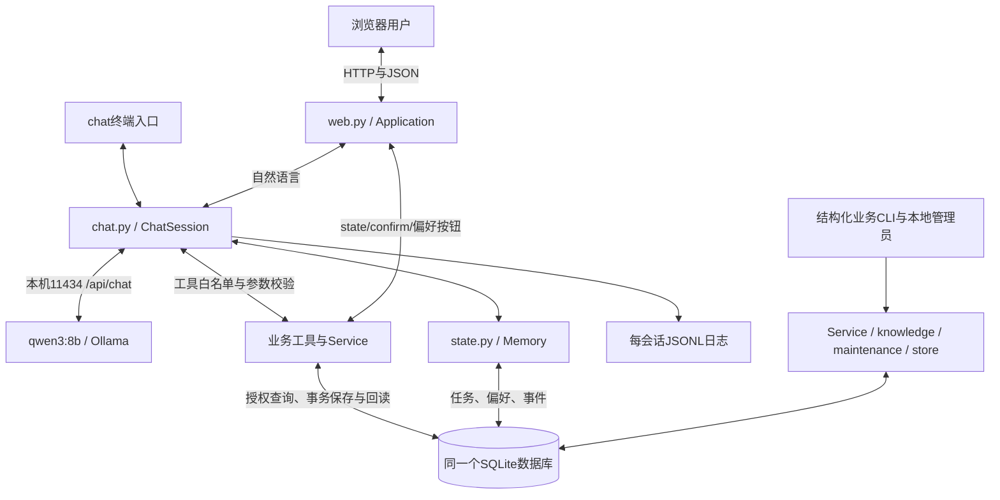

# 架构图与模块职责

代码基线：bab7940，版本0.4.0。图中的用户身份是比赛演示身份选择，不是生产账号认证。

[PNG版本](figures/architecture.png) · [SVG版本](figures/architecture.svg)

## 用户请求怎样进入并返回

网页HTML、CSS、JS由本机8765端口提供。用户点击进入会话时，/api/start固定用户、企业及入口月份，创建ChatSession、恢复当前任务与偏好，返回会话令牌。自然语言随后通过/api/chat进入Application.call，检查令牌并获取会话锁，再调用ChatSession.turn。

ChatSession选择本轮需要的身份、月份、结构化记忆、最近对话和工具定义，调用本机Ollama。模型返回工具请求时，dispatch负责白名单和参数来源检查，真正计算、查库、保存由程序执行。工具结果以role=tool加入下一次模型输入；模型生成回答后，程序补充必要依据和草稿提示，网页收到JSON后用安全的文本节点显示。

网页再请求/api/state刷新金额、发票、银行记录、任务快照、规则和审计。这个刷新不调用模型。它也不重新计算用途任务；需要通过check、/memory、新会话恢复或保存后的Memory.refresh刷新任务进度。

## 每个模块负责什么

| 模块 | 职责 | 不是它负责的内容 |
| --- | --- | --- |
| static/app.js | 收集输入、发HTTP请求、显示回答、确认按钮和资料面板 | 不计算业务金额、不直接改数据库 |
| web.py | 本机HTTP、来源检查、会话令牌、会话锁、入口身份绑定和页面直接操作 | 不理解自然语言、不代表生产登录系统 |
| chat.py / ChatSession | 上下文、模型工具循环、参数来源、内存草稿、确认程序与日志 | 不信任模型自称“已保存” |
| chat.py / Ollama | 把messages与tools发送到/api/chat，读取助手消息，处理模型连接错误 | 不执行模型提出的工具 |
| service.py | 金额、发票、用途检查、权限、字段限制、保存事务、幂等、回读 | 不生成或猜测用途 |
| state.py | 用户企业隔离、任务刷新、明确偏好与删除、备份后迁移 | 不恢复修改授权或完整聊天 |
| knowledge.py | 本地规则导入、版本不可覆盖、启停及冲突检测 | 不自动证明正文与结构条件语义一致 |
| store.py / excel.py | 数据结构、原始XLSX导入、整数分与日期处理 | 不把原Excel当成修改后的当前数据 |
| maintenance.py | 已知结构检查、SQLite一致性备份、校验与恢复到新文件 | 不把Git代码回滚等同于业务数据回滚 |

对应代码：[web.py](../../tax_harness/web.py)、[chat.py](../../tax_harness/chat.py)、[service.py](../../tax_harness/service.py)、[state.py](../../tax_harness/state.py)、[knowledge.py](../../tax_harness/knowledge.py)、[store.py](../../tax_harness/store.py)。

## 模型怎样参与

默认运行模型只有qwen3:8b。理解需求、决定查询或追问、提出工具调用、组织自然语言回答，都由同一个模型承担。某次更正如果只生成文字而没有工具，程序可能再给同一个模型一次有界决策机会，这不是独立检测模型。

业务校验由Python和SQLite完成。bge-m3没有接入，规则依靠结构化企业、日期、状态、类型筛选，不经过向量数据库。旧qwen3:0.6b只出现在历史失败证据中。

一次用户自然语言请求可能调用模型1至5次，不能把所有请求画成固定两次。成功的“一个工具加一次最终回答”常见为两次。一次模型返回的工具请求最多8个，程序顺序执行，不是并发多Agent。

上下文最多选择最近4轮完整消息，受18000字符预算约束，本轮消息总量超过24000字符会报错；这些是字符预算，不是精确token计量。对象内最多保留8轮，旧完整对话不会被当作跨会话记忆自动载入。

## 状态实际写在哪里

| 状态 | 保存位置 | 谁写 | 新会话是否恢复 |
| --- | --- | --- | --- |
| 会话令牌、锁、当前身份 | Application.sessions内存 | /api/start | 不恢复，重新进入 |
| 当前月份与近期对话 | ChatSession内存 | 入口、查询工具、对话循环 | 月份可从活动任务恢复；对话全文不恢复 |
| pending草稿、原值快照、操作编号 | ChatSession内存 | prepare_update | 不恢复 |
| 发票用途与备注 | invoices表 | Service.update确认事务 | 保留当前值 |
| 银行记录 | bank_records表 | 初始化导入，业务入口只读 | 保留 |
| 修改前后与操作编号 | audit_log表 | 与发票修改同一事务 | 可查询 |
| 月份、待补编号、更新时间 | tasks表，用户与企业组合键 | Memory.track/refresh | 恢复后重新查询 |
| 明确偏好、来源、更新时间 | preferences表 | 显式命令或表单 | 恢复 |
| 任务与偏好操作类型 | state_events表 | Memory | 作为审计，不当作授权 |
| 规则正文、版本、条件和状态 | rules表 | 本地规则管理 | 业务工具实时选择 |
| 规则管理动作 | rule_events表 | knowledge | 作为审计 |
| 实际模型输入输出、工具与选用记忆 | JSONL文件 | ChatSession.record | 供查看，不自动恢复 |

上述数据库表在同一个business.sqlite3里。tasks只存待处理编号，没有单独的已完成编号表，也不存用途草稿；已完成内容通过当前发票和审计核对。

## 三个容易误解的点

“用户只是查资料”也可能产生运行日志或任务进度写入；应区分业务写入和运行状态写入。totals不修改发票、不创建检查任务；check会写任务进度；进入有活动任务的新会话会重新检查并刷新任务。

发票更新与audit_log属于同一个事务。提交后的任务刷新是另一个事务；任务刷新失败不等于发票没保存。日志文件写入也不与数据库原子提交。

最终模型文字目前没有完备的事实一致性验证器。权限、参数、保存路径有程序控制，但模型仍可能说错或遗漏内容。失败案例集展示了这类差别。
