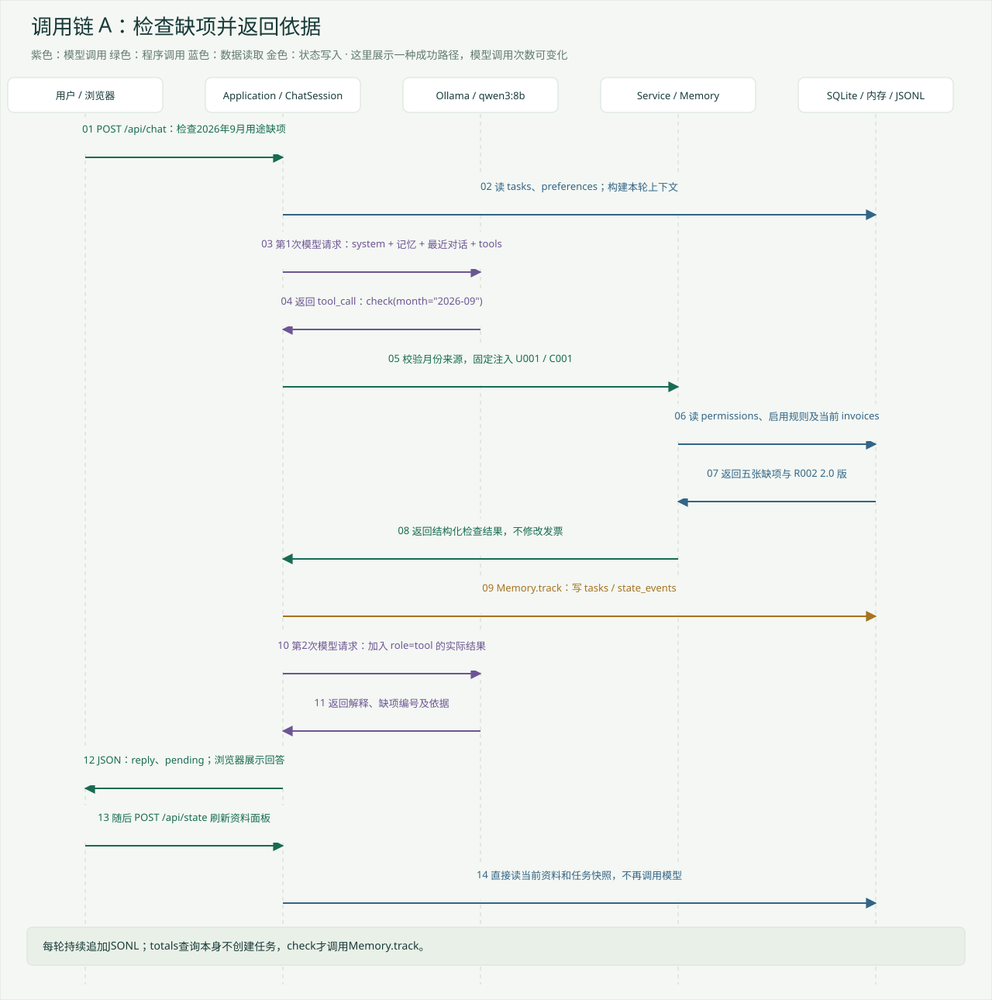
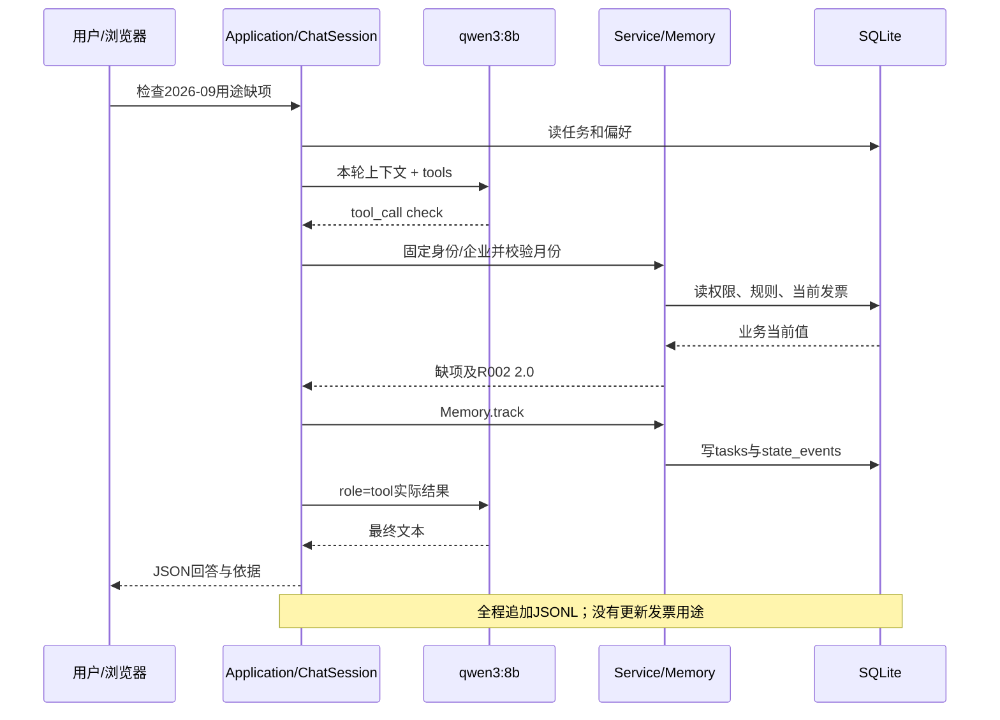
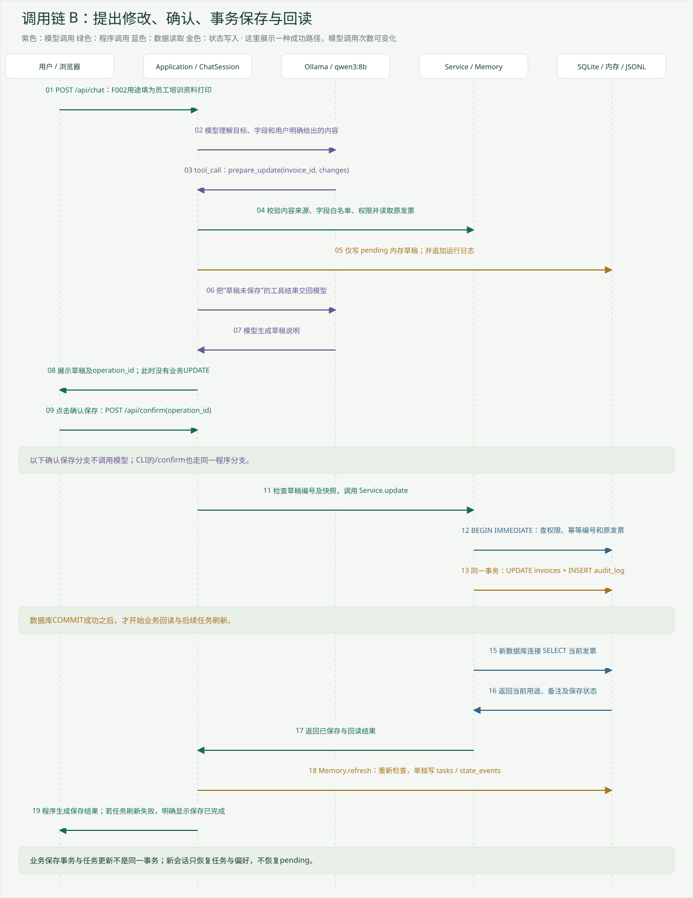
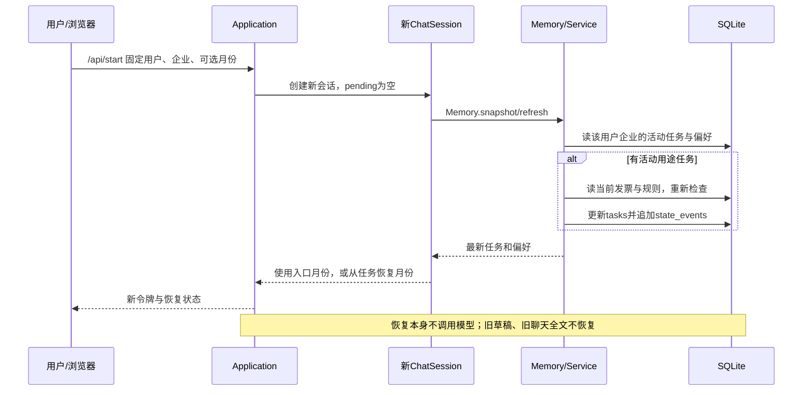

# 调用链路与状态变化

本文件对应0.4.0实际代码。每条链明确区分模型调用、程序工具和状态写入。日志对话只是一种成功路径，模型可能增加查询或追问，不是固定场景脚本。

## A 检查九月用途缺项

前提：U001、C001，入口或本轮已明确2026-09。原始数据有五张必填用途缺项。

[PNG版本](figures/query-chain.png)

| 步骤 | 调用 | 模型 | 读取与写入 |
| --- | --- | --- | --- |
| 1 | app.js → POST /api/chat → Application.call | 无 | 读令牌与绑定身份，更新会话使用时间，持有会话锁 |
| 2 | ChatSession.turn/_turn | 无 | 追加user_input；清除旧pending；读取任务与偏好，选择最近对话 |
| 3 | Ollama.chat → localhost:11434/api/chat | qwen3:8b | JSONL记录完整本次输入、tools、选用记忆和模型输出 |
| 4 | 模型返回check(month) → dispatch | 无额外模型 | 校验工具名、参数、月份来源；用户企业由程序注入 |
| 5 | Service.check → authorize/select_rule | 无 | 读permissions、当前invoices、启用且适用的rules，按空白与门槛计算缺项 |
| 6 | Memory.track | 无 | 有缺项则新增/覆盖该用户企业的tasks；没有则删除活动任务；追加state_events |
| 7 | role=tool回到Ollama.chat | 同一个qwen3:8b | 追加工具结果，再生成最终说明 |
| 8 | 返回reply、pending | 无 | 程序补依据、保存近期消息、追加answer日志，网页显示 |
| 9 | 浏览器自动POST /api/state | 无 | 再读金额、发票、银行、规则、任务快照与审计，不重新执行用途检查 |

金额查询用totals替代check，调用Service.totals以整数分汇总；它本身不写tasks。发票查询用invoice，仅查企业和编号共同定位的一张发票。规则查询用rules，由ChatSession.dispatch直接组合select_rule的结果，不是Service.rules方法。

## B 修改草稿与确认保存

[PNG版本](figures/save-chain.png)

第一段是自然语言：“将F002用途填写为员工培训资料打印”。模型请求prepare_update；程序核对字段、用户本轮提供的原文、写权限，调用Service.invoice取得原值，再生成pending草稿。这个步骤不执行业务UPDATE，也没有audit_log保存记录。日志文件仍会记录草稿及工具结果。

pending包含invoice_id、changes、before及operation_id。浏览器只显示必要字段；before留在服务端内存。模型取得“草稿未保存”的工具结果，再组织说明。

第二段是用户点击确认保存。浏览器发送operation_id到/api/confirm，Application比对当前草稿编号，然后直接执行ChatSession.turn('/confirm')，这一段不调用模型。

| 确认步骤 | 程序调用与校验 | 状态变化 |
| --- | --- | --- |
| 1 | 确认草稿存在、按钮编号匹配 | 取出并清除内存pending，避免重复提交 |
| 2 | Service.invoice核对当前值与before | 不符时报stale_draft，不覆盖其他会话更正 |
| 3 | Service.update / BEGIN IMMEDIATE | 重新检查写权限、operation_id、字段和事务内快照 |
| 4 | UPDATE invoices + INSERT audit_log | 同一事务写用途/备注与修改前后证据 |
| 5 | COMMIT | 此时业务已提交 |
| 6 | 新连接调用Service.invoice | 回读当前保存结果，返回saved、matches_requested等 |
| 7 | Memory.refresh → Service.check → Memory.track | 另一个事务更新剩余缺项；失败时保留明确警告 |
| 8 | 程序生成保存回复，网页再刷新state | 不调用模型；回读、日志和任务更新各有明确边界 |

Service.update识别同一operation_id的相同请求，不重复写入；相同编号用于不同内容会冲突。常规网页确认时pending已经清除，所以第二次点击同一按钮会被拒绝。若已提交后新连接回读失败，当前还没有完整的“已提交但未复核”状态恢复协议；不能把所有异常都理解成数据已回滚。

## C 新会话恢复

如果入口明确选择了月份，它优先于从任务补入的月份。网页默认可见月份2026-09，因此已构成明确的入口上下文；历史“未给月份却猜九月”的失败是没有入口月份的新会话，不应混为一谈。

仅金额查询不创建持久任务。task只覆盖九月用途检查。启动时刷新失败会阻止本次恢复进入，原任务不因失败而删除，需要通过管理员入口修复规则或清除任务。

## D 所有工具与直接操作的对应表

| 请求/工具 | 实际实现 | 是否调用模型 | 业务与状态写入 |
| --- | --- | --- | --- |
| 自然语言问题 | ChatSession.turn → Ollama.chat | 1至5次qwen3:8b | 日志、近期消息，按工具决定其他写入 |
| totals | Service.totals | 工具执行本身无模型 | 改内存month，不写发票或任务 |
| check | Service.check + Memory.track | 工具执行本身无模型 | tasks、state_events、内存month |
| invoice | Service.invoice | 工具执行本身无模型 | 只读业务数据，另有运行日志 |
| rules | ChatSession.dispatch + select_rule | 工具执行本身无模型 | 只读规则，更新内存month |
| prepare_update | ChatSession.dispatch + authorize + Service.invoice | 工具执行本身无模型 | 内存pending及日志；不写业务表 |
| /api/confirm或/confirm | ChatSession确认分支 + Service.update | 无 | invoices、audit_log；随后独立刷新任务 |
| /api/state | Application.state | 无 | 查询与读取现有任务快照；不写任务 |
| 偏好表单 | Memory.preference | 无 | preferences、state_events；清除pending，追加ui_preference日志 |
| /pref、/forget | ChatSession显式命令 → Memory | 无 | 同样管理偏好并追加用户输入日志 |
| /memory | Memory.refresh | 无 | 重新查询，可能写tasks/state_events；清除pending |
| /prefs | Memory.snapshot | 无 | 读取偏好，清除pending，仍记录用户输入 |
| 删除任务 | Memory.clear_task | 无 | 删除tasks，写state_events；已存用途不撤销 |
| 规则导入/启停 | scripts/manage.py → knowledge | 无 | rules与rule_events在事务内更新，冲突回滚 |
| menu/结构化业务CLI | __main__.py → Service | 无 | update可直接保存，不经过AI草稿确认 |
| init | store.initialize/excel.read_workbook | 无 | 仅新库导入业务数据、权限和初始规则；旧库不覆盖 |
| migrate | state.upgrade | 无 | 备份旧库后事务增加已知表，保留原业务记录 |
| 备份恢复 | maintenance.backup/restore | 无 | 新快照/新目标文件；不覆盖当前业务库 |

不同路线的日志并不完全相同：模型自然语言轮次有完整model_input/tool_result；页面资料刷新并不会生成模型调用日志。SQLite审计记录与JSONL运行记录不能互相替代。
