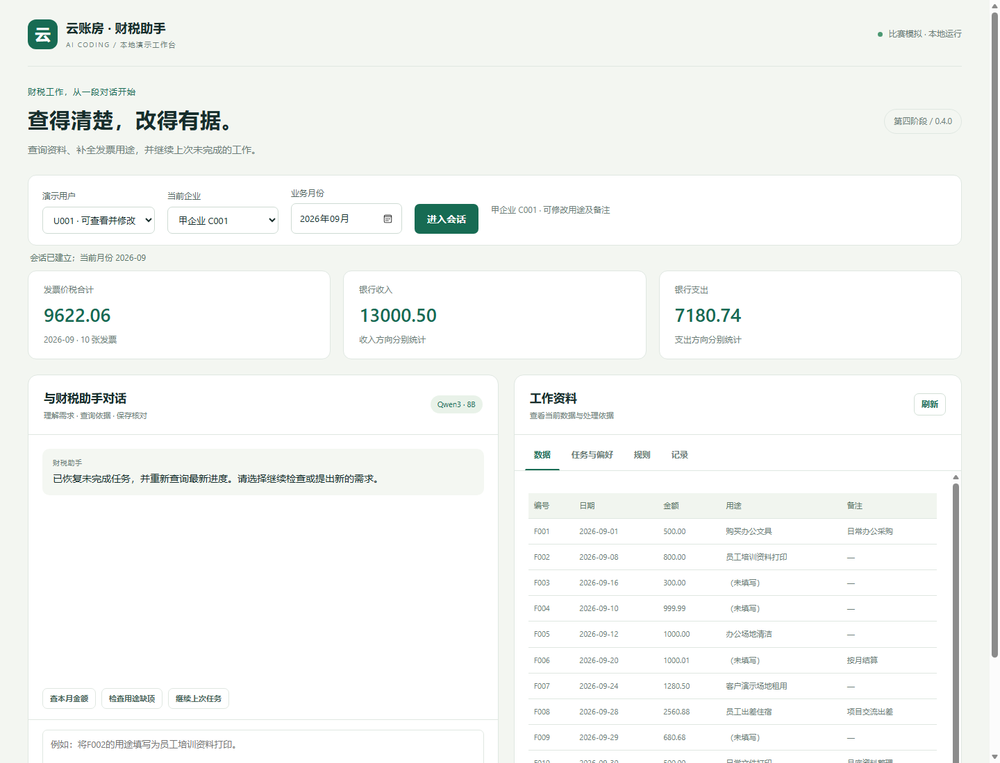
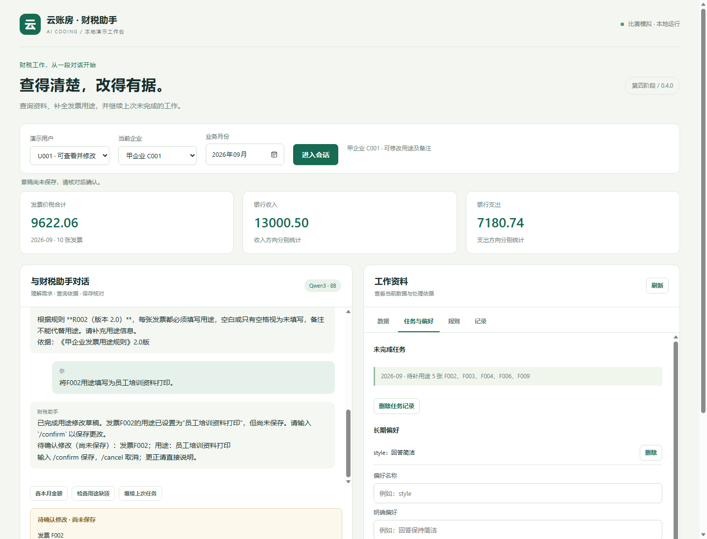
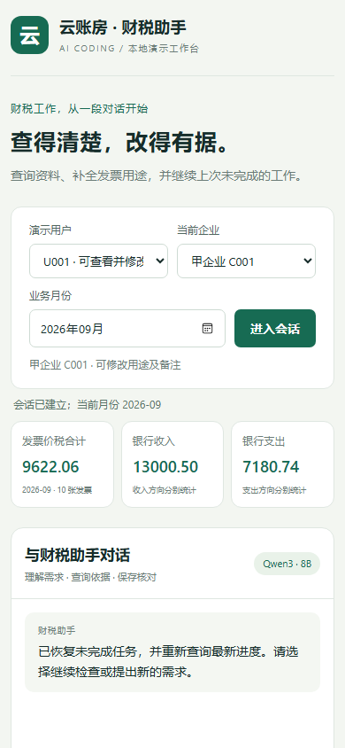

# 第四阶段验收记录

日期：2026年11月4日。版本0.4.0。环境：Windows、Python 3.14.7、本机Microsoft Edge、Ollama qwen3:8b。

| 验证 | 结果 | 证据 |
| --- | --- | --- |
| 程序及真实HTTP回归 | 60项通过 | [完整输出](unit-tests.txt) |
| 最终网页与真实模型验收 | 15项通过 | [结果](20261104T075823Z-d25e313c/result.json) |
| 真实模型长对话及故障恢复 | 5项通过 | [结果](20261104T075436Z-c9a1a6ee/result.json) |
| 旧代码与数据恢复演练 | 5项通过 | [结果](../recovery/20261104T075448Z-5dfb7d53/result.json) |

浏览器验收实际操作DOM中的表单与按钮，独立查询数据库确认真实保存值。覆盖金额、自然查询、偏好保存及删除、草稿未提交、确认回读、企业同号隔离、任务恢复、规则、当前会话日志、范围切换失效、只读权限、无权企业、手机宽度及浏览器运行异常。

长对话验收在12轮真实模型交流后，另一个会话修改F002，再要求继续检查。模型重新查询并列出最新四张缺项。测试进程可控模拟连接离线，不停止实际Ollama服务；断线后草稿清除、没有新增业务写入，恢复真实连接后正常查询，新会话任务仍在。

另有数据库测试验证：发票保存成功后任务刷新失败，回复明确说明业务已经保存与任务刷新失败，不误报业务保存失败。

## 页面预览

桌面页面：

待确认草稿：

手机宽度：

本目录所有模型、截图和恢复证据来自模拟测试库。临时服务和浏览器在验收后已停止，日常使用请通过web.cmd或web命令启动。
